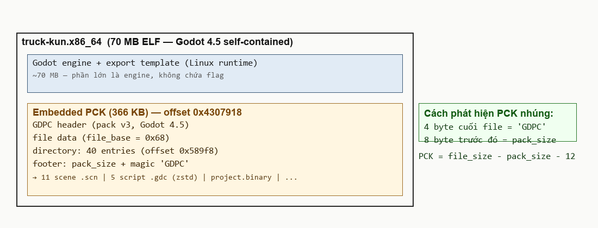
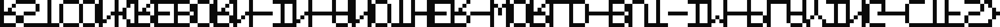
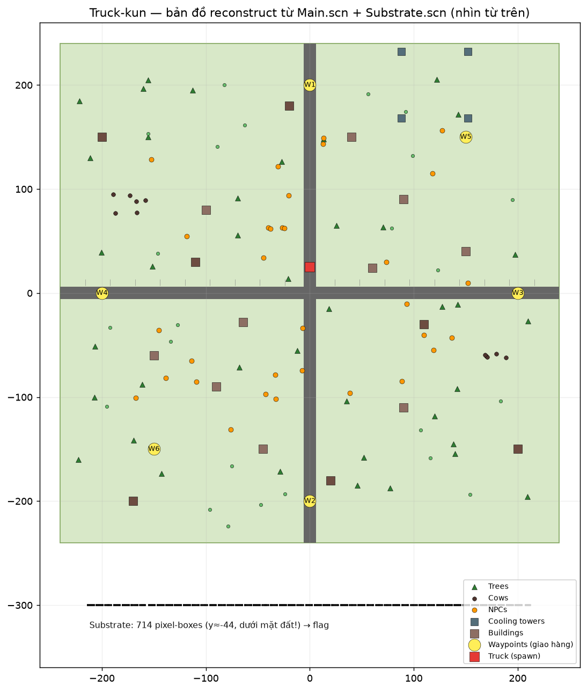

# Truck-kun — Writeup

| | |
|---|---|
| **Challenge** | Truck-kun (10 điểm) |
| **Event** | RSTCON 2026 |
| **Author** | Veryyes |
| **Category** | Reverse Engineering — Game (Godot) |
| **File** | `truck-kun.x86_64` (70 MB) |
| **Flag** | `rstcon{reborn-in-another-world-but-im-playing-ctfs}` *(case-insensitive)* |

> 頑張ってトラックくん! — "Cố lên nhé Truck-kun!"
>
> *Note: flag is case-insensitive.* ← gợi ý quan trọng: flag nằm ở dạng **hình ảnh/pixel font** (chứ hoa), không phải chuỗi plaintext.
>
> *Joke: Truck-kun = meme isekai (xe tải tông → xuyên không) → "reborn in another world but I'm playing CTFs" 🚛🔮*

---

## 1. Nhận diện file: game Godot self-contained

`truck-kun.x86_64` là ELF Linux x86-64 kích thước **70 MB** — quá lớn cho một binary thường. Đọc 4 byte cuối file:

```
$ xxd truck-kun.x86_64 | tail -1
...  7c960500 00000000 47445043   ← "GDPC"
```

Magic **`GDPC`** ở cuối file = **Godot PCK nhúng** (embedded package) — đây là game Godot 4.5 xuất bản self-contained: engine + toàn bộ resource của game gói trong 1 file ELF.



Cách定位 PCK:
- 4 byte cuối: magic `GDPC` (footer)
- 8 byte trước đó: `pack_size` = 366,204
- Vị trí PCK = `file_size − pack_size − 12` = offset **0x4307918**

## 2. Parse PCK v3 (Godot 4.5)

Format PCK v3 có điểm khác biệt so với bản cũ:

```
[GDPC header: pack_ver=3, godot 4.5, flags, file_base=0x68 ... 64B reserved]
[file data ...]        ← offset mỗi file tính từ: pck_start + file_base
[directory @ +0x589f8] ← 40 entries: path, offset, size, md5, flags
[footer: pack_size + "GDPC"]
```

Đặc biệt: **directory nằm ở CUỐI PCK** (không phải ngay sau header như v1/v2), và offset của file tính từ `pck_start + file_base (0x68)`.

Extract được 40 files:

```
.godot/exported/.../export-...-Main.scn        33 KB   scene chính
.godot/exported/.../export-...-Substrate.scn   75 KB   ★ "đáy" bản đồ
.godot/exported/.../export-...-{Truck,NPC,HUD,Waypoint,...}.scn
scripts/Main.gdc, Truck.gdc, NPC.gdc, HUD.gdc, Waypoint.gdc   (GDScript bytecode)
project.binary, bgm.ogg, icon.svg, ...
```

## 3. Giải nén GDScript (.gdc = zstd)

Script `.gdc` có header `GDSC` + version 101, phần thân là **kén zstd** (magic `28 b5 2f fd`):

```python
d = open('Main.gdc','rb').read()
dec = zstd.ZstdDecompressor().decompress(d[12:])   # → 6292 bytes token stream
```

Trong bytecode:
- **Identifier table** bị obfuscate nhẹ: mỗi ký tự lưu UTF-32LE rồi **XOR 0xB6** → decode được `Node3D`, `@onready`, `truck`, `waypoints`... và cả action `reset_vehicle`, `toggle_camera`.
- **Constant pool** (plaintext): chỉ có

```
'WASD / Arrows: Drive   Space: Handbrake   R: Reset truck'
'Cargo loaded! Deliver it to the GREEN marker.'
'Delivered! +1'
'%d km/h', 'Deliveries: %d', '%02d:%02d'
```

→ **Không có flag trong code.** Logic game là delivery bình thường (lấy hàng → giao ở waypoint xanh → +1 điểm). Flag phải nằm ở *data*, không phải *logic*.

## 4. Substrate.scn — 714 pixel-boxes

File lớn nhất trong các scene là `Substrate.scn` (75 KB). Parse binary resource (RSRC) của Godot:

- String table trong scene: **không padding** (khác resource thông thường)
- Dictionary `_bundled` dùng marker riêng của SceneState: key = `05 + len + data`, value tag enum riêng: `17 = Transform3D`, `24 = Object`, `12 = Vector3`, `2 = INT32`, `4 = FLOAT32`
- Node record: `[parent, owner, type, name, instance, prop_count, (name_idx, variant_idx)*, group_count, group_idxs*]`

Kết quả: **715 nodes** = 1 root `Substrate` + **714 × MeshInstance3D** tên `P1..P714` — mỗi node là một **BoxMesh** (pixel!) với một transform.

Đọc 714 transform → origin tạo thành lưới:

- **253 giá trị X** khác nhau (−213.5 → 212.1, bước 1.4)
- **7 giá trị Y** (−48.4 → −40.0)
- Z cố định **−300**

→ 714 điểm = lưới **253 × 7** = một banner pixel font 7 điểm chiều cao!

## 5. Render → decode pixel font

Vẽ occupancy grid (ô có box = `#`), 7 hàng × 253 cột:

```
####..#########.####.###.#...#..######.#########..###.####.#...#.....######...#......###.#...#.###.######...##########......#...#.###.####.#....####......####.#...######.....######...#.....####.#.....###.#...#######...#.####......##############.######..
#...##......#..#....#...###..#..#.#...##....#...##...##...###..#.......#..##..#.....#...###..##...#..#..#...##....#...#.....#...##...##...##....#...#.....#...##...#..#.........#..##.##.....#...##....#...##...#..#..##..##.........#......#..#....#.....#..
#...##......#..#....#...##.#.#.#..#...##....#...##...##...##.#.#.......#..#.#.#.....#...##.#.##...#..#..#...##....#...#.....#...##...##...##....#...#.....#...##...#..#.........#..#.#.#.....#...##....#...#.#.#...#..#.#.##.........#......#..#....#......#.
####..###...#..#....#...##..####..####.####.####.#...#####.#..#######..#..#..#############..###...#..#..#########.####.######.#.##...#####.#....#...##########.#...#..#..#####..#..#...##########.#....#####..#....#..#..###..########......#..####..###...##
#.#......#..#..#....#...##...#.#..#.#..#....#...##...##.#..#...#.......#..#...#.....#...##...##...#..#..#...##....#.#.......#.#.##...##.#..#....#...#.....#...##...#..#.........#..#...#.....#....#....#...#..#....#..#...##...#.....#......#..#........#..#.
#..#.....#..#..#....#...##...#..#.#..#.#....#...##...##..#.#...#.......#..#...#.....#...##...##...#..#..#...##....#..#......##.###...##..#.#....#...#.....#...##...#..#.........#..#...#.....#....#....#...#..#....#..#...##...#.....#......#..#........#.#..
#...#####...#...####.###.#...#..###...##########..###.#...##...#.....######...#.....#...##...#.###...#..#..#...#######...#.....#...#.###.#...##########......####..###...#.......######...#.....#....######...#..#..######...#.####......####..#..#....####.##..
```

Render thành PNG (mỗi pixel box phóng ×8) cho dễ đọc:



### Cái bẫy: đọc bằng mắt sẽ SAI

Lần đầu mình đọc ảnh này bằng mắt + vision model được `RSTCON{DR1VE_SAFE_DEL1VER_RENEGADE}` (35 ký tự) — **submit sai**. Nguyên nhân: font trong game là **font dính** — mỗi ký tự đúng 5 cột, xếp sát nhau **không có cột trống ngăn cách** (đó là lý do không thể tách chữ theo khoảng trắng: 253 cột không có cột nào rỗng hoàn toàn). Chữ dính chữ làm mắt/vision-model gộp nhầm các glyph.

### Decode đúng: template matching theo pitch 5

Quan sát then chốt: 253 cột / 5 = 50.6 → ký tự xếp **pitch đều 5 cột**, chữ đầu `R` nằm ở cột 0–4, `S` ở 5–9, `T` ở 10–14 (thân T = cột 12 — trùng cột full-height quan sát được)... và `{` chỉ **4 cột** (30–33) làm mọi chữ sau nó lệch pha +1.

1. Tách grid thành các cell 5 cột (chỉnh offset sau `{`)
2. Dựng **font atlas** ngay từ dữ liệu: dùng 7 ký tự biết trước `R S T C O N {` để bắt tay, rồi nhận diện tiếp `E B O _ I A H W L D U M P Y G F S }`
3. Ghép chuỗi: các cell ở cột 34, 39, 44, ... đọc ra `R E B O R N - I N - A N O T H E R - W O R L D - B U T - I M - P L A Y I N G - C T F S }`

Ví dụ vài cell (cột 34, 39, 44):

```
R         E         B
####.     #####     ####.
#...#     #....     #...#
#...#     #....     #...#
####.     ####.     ####.
#.#..     #....     #...#
#..#.     #....     #...#
#...#     #####     ####.
```

**Xác minh pixel-perfect**: render lại toàn bộ chuỗi decode từ atlas rồi XOR với lưới gốc — kết quả **0/1771 pixel sai**, tổng độ rộng render 253 = 253 cột thật.

```
RSTCON{REBORN-IN-ANOTHER-WORLD-BUT-IM-PLAYING-CTFS}
```

### Cái bẫy thứ hai: `-` đọc nhầm thành `_`

Sau khi bản đọc đầu submit sai, đối chiếu atlas với bảng font chuẩn **AVRlib font5x7** (Pascal Stang — font 5x7 được copy khắp nơi, và là nền của font này) phát hiện: glyph phân cách có thanh ngang ở **hàng giữa (row 3)** = **dấu gạch ngang `-`**. Underscore thật nằm ở **hàng cuối** (`[0x40]×5` mỗi cột). Điểm kiểm chứng thêm:

- Các glyph `R E W O S T M B` khớp **byte-perfect** với AVRlib → font của game là biến thể AVRlib
- Kiểm tra các vị trí dễ nhầm `O/I/S/B` với bitmap digit AVRlib (`0/1/5/8`) → **không khớp vị trí nào** → toàn là chữ cái, không có leet

Bài học: khi decode pixel font, **đừng gán tên ký tự theo thói quen** (thanh ngang phân cách = `_`?) — hãy đối chiếu bitmap với một bảng font tham chiếu, và các vị trí ambiguous (O/0, I/1, S/5, B/8) phải test từng cặp với bitmap digit thật của font.

Đề ghi *case-insensitive* vì pixel font chỉ có chữ hoa — submit thường/hoa đều được.

## 6. Flag nằm ở đâu trong game?

Reconstruct toàn bộ `Main.scn` (247 nodes: đường, waypoint W1–W6, truck spawn, 18 NPC, 40 cây, bò, cột điện, building...) và đặt banner Substrate đúng tọa độ thế giới:



Chi tiết thú vị: banner nằm ở **z = −300** (bản đồ chỉ trải tới ±240) và **y ≈ −44** — tức là **chìm dưới mặt đất và ngoài phạm vi bản đồ**. Dù có lái xe tới đó cũng không thấy gì: đây là "kho dữ liệu" của flag, chỉ đọc được bằng cách extract + render — đúng tinh thần reversing.

## Flag

```
rstcon{reborn-in-another-world-but-im-playing-ctfs}
```

*(Truck-kun tông → xuyên không sang thế giới khác… mà vẫn ngồi chơi CTF 🚛🔮)*

---

## Tóm tắt các bước

1. **Nhận diện**: ELF 70 MB + magic `GDPC` cuối file → Godot self-contained export.
2. **Tách PCK v3**: footer chứa `pack_size` → tính offset PCK; directory nằm cuối PCK; offset file tính từ `pck_start + file_base`.
3. **Giải nén .gdc**: header `GDSC` + zstd; identifier XOR 0xB6 (UTF-32LE); constants plaintext → flag không nằm trong code.
4. **Parse Substrate.scn**: binary RSRC + SceneState enum riêng → 714 node BoxMesh (P1..P714) với transform.
5. **Render**: 253×7 occupancy grid → pixel font.
6. **Decode đúng**: font dính pitch 5 cột/ký tự (`{` and `}` chỉ 4 cột làm lệch pha) → tách cell + template matching + verify render lại **0 pixel sai** → flag.
7. **Bonus**: reconstruct bản đồ — flag chìm dưới đất ngoài map, vô hình khi chơi.

## Bài học & kỹ năng

- **Godot forensics**: PCK nhúng xác định qua footer `GDPC` + `pack_size`; format v3 đổi vị trí directory sang cuối và thêm `file_base`. Các tool PCK phổ thông (godotpcktool...) thường chỉ hỗ trợ v1/v2 — nhiều khi phải tự viết parser.
- **Obfuscation nhẹ của Godot 4.4+**: identifier trong `.gdc` XOR 0xB6 UTF-32; script body nén zstd. Không khó, nhưng phải nhận ra được từng lớp.
- **Flag trong data, không trong logic**: game hoàn toàn vô tội về mặt code — flag giấu trong geometry. Khi reversing game engine, luôn hỏi "data nào lớn bất thường?" (file 75 KB giữa những file 3 KB).
- **Đừng tin việc đọc pixel art bằng mắt**: mắt người và vision-model đều dễ gộp nhầm các glyph dính nhau. Đoán cấu trúc font (pitch đều 5 cột → 253/5 ≈ 50 ký tự) rồi **verify bằng cách render lại chuỗi decode và so pixel** — kết quả 0 sai khác mới là chứng minh, không phải "đọc được là xong". Lần đọc đầu (`DR1VE_SAFE_DEL1VER_RENEGADE`, 35 ký tự) sai chính vì tin vào mắt.

## Danh sách file ảnh

| File | Nội dung |
|---|---|
| `tk_01_map.png` | Bản đồ game reconstruct + vị trí banner flag |
| `tk_02_pck.png` | Sơ đồ cấu trúc file + PCK nhúng |
| `tk_03_flag.png` | Pixel-art flag (714 box → 253×7 grid) |

*Intermediates: `D:\ctf\tk\` — script parse, `substrate.json`, `origins.json`, `art.txt`, `flagtext.png`.*
